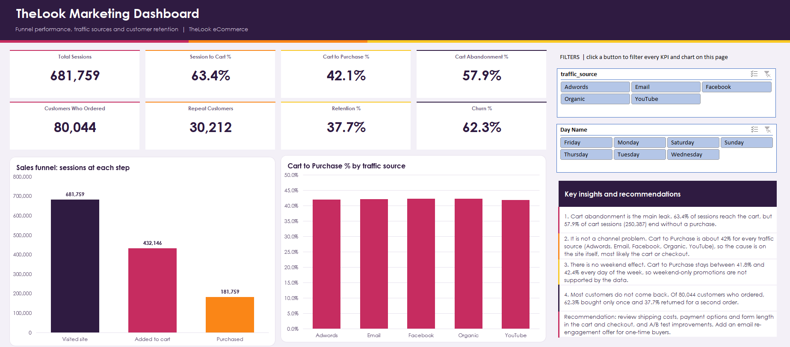
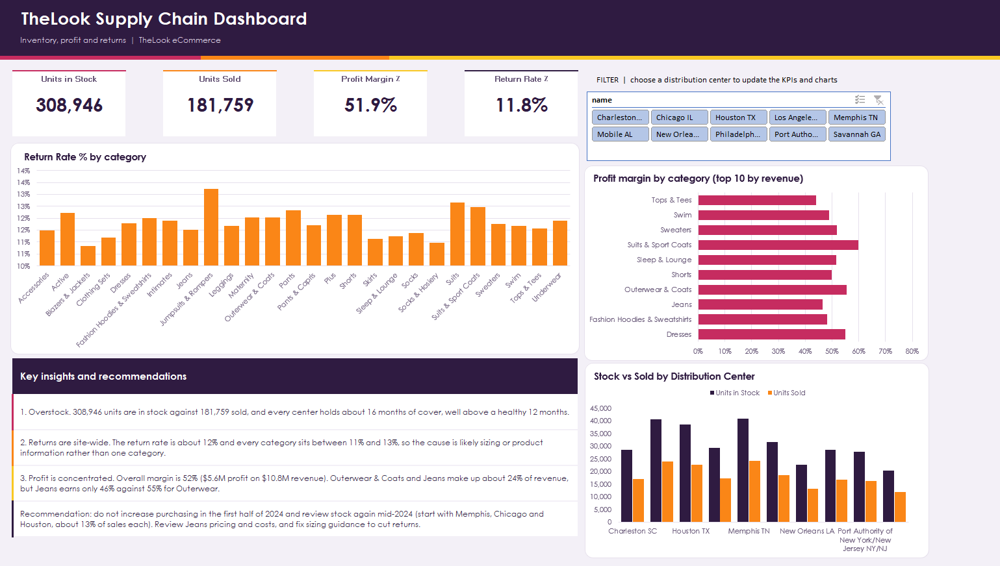

# TheLook eCommerce Analytics (Advanced Excel)

An end-to-end Excel analytics project on the TheLook eCommerce dataset: Power Query, Power Pivot, DAX, ETS forecasting, pivot tables and two interactive dashboards (Marketing and Supply Chain).

**Download the workbook:** [Google Drive folder](https://drive.google.com/drive/folders/1lT5uKfJMP-r4hS9GgCMXlUrxazWDR3CY?usp=sharing)
(The file is large because of the embedded Data Model, so it is not stored in the repo itself. Download it and open it in desktop Excel to use the slicers and pivot charts. Google Sheets does not support them.)

## Business problem

TheLook struggles with high cart abandonment and product returns. The goal was to find **where** users drop off in the customer journey and **why**, then turn the findings into concrete recommendations.

## Tools and methods

| Phase | What I did |
|---|---|
| 1. Data engineering | Loaded Users, Events, Orders, Order_Items, Products, Inventory_Items and Distribution_Centers with Power Query as **connection only** to the Data Model (the Events table has about 2.4M rows). Removed unneeded columns, handled nulls, and added Day of Week and session duration. |
| 2. Web behavior and funnels | Built Session-to-Cart and Cart-to-Purchase conversion by day and by traffic source. |
| 3. Forecasting | Aggregated monthly revenue (Jan 2019 to Dec 2023) and used Excel Forecast ETS with 95% confidence bounds. Converted the forecast to units and split it by distribution center to plan stock. |
| 4. Modeling and dashboards | Built relationships in Power Pivot and wrote DAX measures for Retention, Churn, Return Rate and Profit Margin. Validated them with pivot tables, then built two dashboards with slicers. |

## Key findings

1. **Cart abandonment is the main leak.** Of 681,759 sessions, 63.4% reach the cart, but 57.9% of cart sessions (250,387) end without a purchase.
2. **It is not a channel problem.** Cart-to-Purchase is about 42% for every traffic source (Adwords, Email, Facebook, Organic, YouTube), so the cause is most likely on the site itself (cart or checkout).
3. **There is no weekend effect.** Conversion stays between 41.8% and 42.4% every day of the week.
4. **Most customers do not come back.** Of 80,044 customers, 62% bought only once and 38% placed a repeat order.
5. **Overstock.** 308,946 units are in stock against 181,759 sold, which is about 16 months of cover at every distribution center (healthy is around 12).
6. **Returns are site-wide.** The return rate is about 12% and every category sits between 11% and 13%, which points to sizing or product information rather than one category.
7. **Profit is concentrated.** Overall margin is 52% ($5.6M profit on $10.8M revenue). Outerwear & Coats and Jeans make up about 24% of revenue, but Jeans earns only 46% margin against 55% for Outerwear.

## Recommendations

- Review shipping costs, payment options and form length in the cart and checkout, and A/B test improvements.
- Send an email re-engagement offer to one-time buyers.
- Do not increase purchasing in the first half of 2024. Review stock again mid-2024, starting with Memphis, Chicago and Houston (about 13% of sales each).
- Review Jeans pricing and costs, and improve sizing guidance to reduce returns.

## Dashboard pages

- **Marketing Dashboard:** funnel KPIs, customer retention and churn, funnel chart and conversion by traffic source. Slicers: traffic source and day of week.
- **Supply Chain Dashboard:** stock and sales KPIs, profit margin and return rate, stock vs sold by distribution center, profit margin by category and return rate by category. Slicer: distribution center.

## Workbook contents

| Sheet | Purpose |
|---|---|
| Data Dictionary | Every table and column, with type and description |
| Web Analytics Terms | Bounce rate, conversion, retention and other terms |
| Project Notes | Method, assumptions, insights and limitations |
| Funnel by Day, Sales Daily, Monthly Sales | Pivot and aggregation layers |
| Forecast Data, Forecast | ETS forecast with upper and lower bounds |
| Inventory Plan | Stock cover per distribution center |
| Returns & Profit, Customers | DAX measure validation |
| Chart Data | Pivot tables behind the dashboard charts |
| Marketing Dashboard, Supply Chain Dashboard | Interactive dashboards |

## Limitations

- Revenue and profit are gross: they include returned items and exclude refunds, so net profit is lower.
- The forecast assumes the strong growth trend continues, and it was built on monthly data because daily data was too noisy.
- Churn is defined as one-time buyers, since the data has no explicit cancellation date.
- The dataset is synthetic (Kaggle), so the patterns are for practice rather than real business conclusions.

## How to open

Open the workbook in desktop Excel (Microsoft 365 or 2019+) with the Power Pivot add-in available. Use **Data → Refresh All** if the numbers look filtered, and clear the slicers before reading the KPIs.

## Data source

TheLook eCommerce dataset (Kaggle / Google BigQuery public data). Synthetic data for training.

## Author

**Hagar Salah**
Email: hagarsalah2311@gmail.com

*Built as Sprint 1 of the INSTANT Data Analysis training.*
